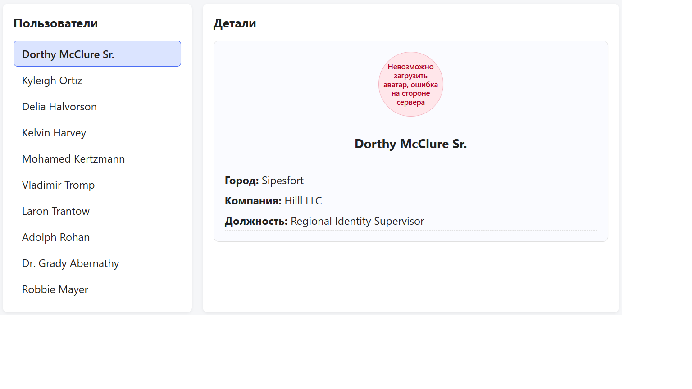

# Users App — список пользователей с деталями

Тестовое приложение на React + Vite: слева — список пользователей, справа — подробная информация о выбранном. Данные подгружаются через `fetch`, вся логика загрузки построена на `useEffect`.

## Демо

## Возможности

- Загрузка списка пользователей при первом рендере (один раз).
- Загрузка деталей пользователя при клике на его имя.
- Индикаторы загрузки для списка, деталей и аватара.
- Понятные сообщения об ошибках сетевых запросов и загрузки аватара.
- Повторный клик по уже выбранному пользователю не перезапускает загрузку.
- Активный пользователь визуально выделен в списке.
- Две колонки: список слева, детали справа (CSS Grid).

## Стек

- React 18 (функциональные компоненты, хуки)
- Vite (сборка и dev-сервер)
- Чистый CSS (без препроцессоров и UI-библиотек)
- `fetch` для сетевых запросов

